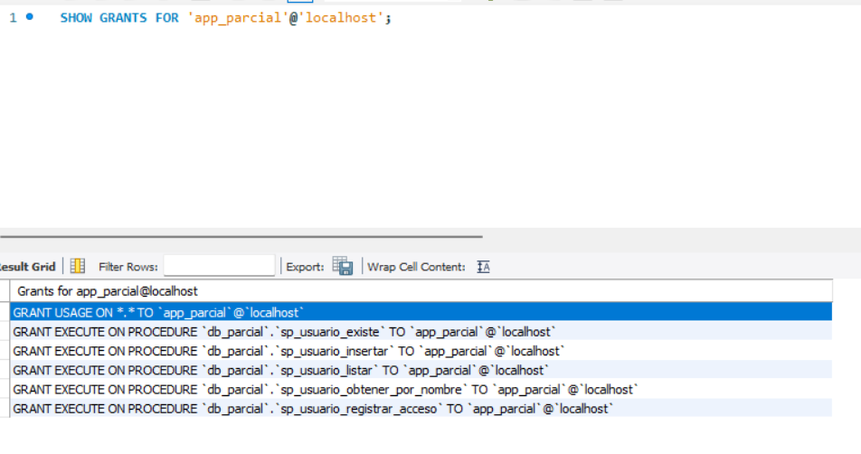
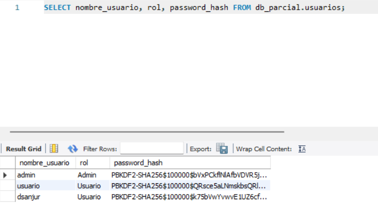
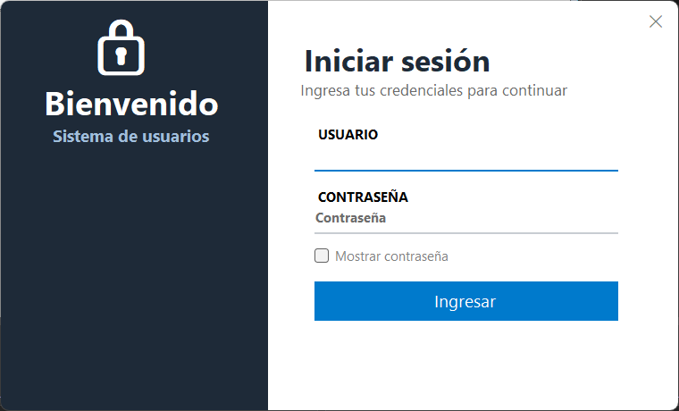
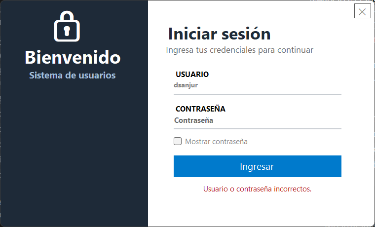
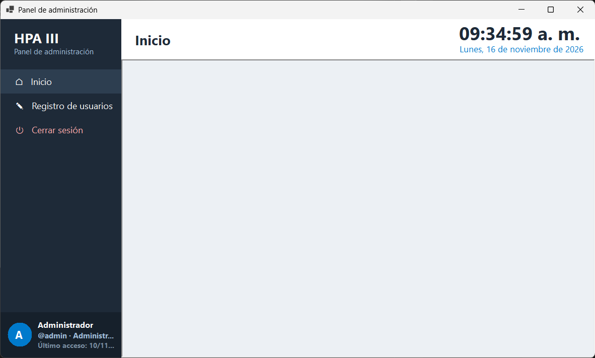
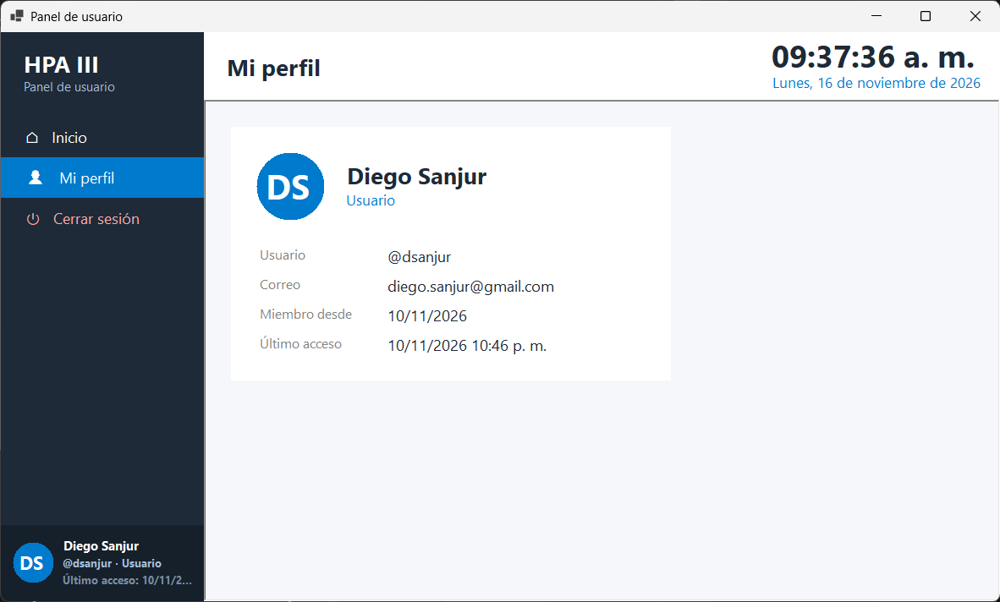
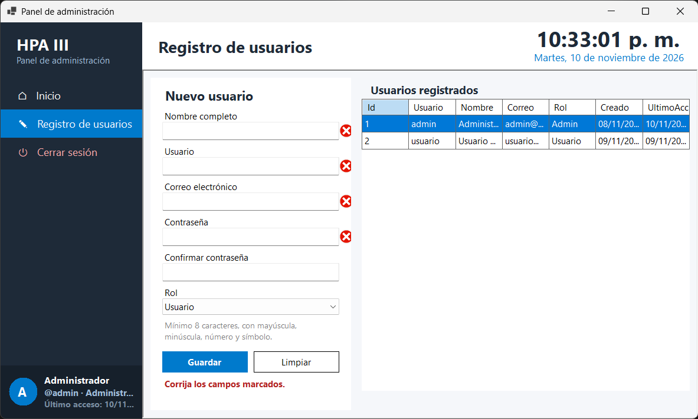
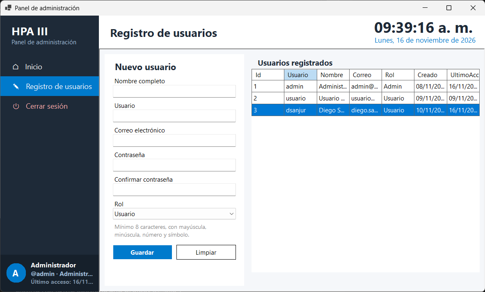

# Parcial #2 — Patrón MVP, Hash de Contraseñas y Arquitectura en Capas

**Universidad Tecnológica de Panamá** — Facultad de Ingeniería de Sistemas Computacionales
Herramientas de Programación Aplicada III (.Net) · Grupo 1IL133 · II Semestre 2026

- **Estudiante:** Diego Sanjur
- **Facilitadora:** Irina Fong

---

## Descripción

Este repositorio contiene la parte práctica del Parcial #2: una aplicación de escritorio en Windows Forms construida con el patrón Modelo–Vista–Presentador sobre una arquitectura de cuatro capas y una base de datos MySQL. El sistema tiene un inicio de sesión con contraseñas protegidas mediante hash, dos tipos de usuario (administrador y usuario normal) con pantallas distintas, un menú lateral con la hora actual y el usuario de la sesión en la parte inferior, un módulo de registro de usuarios con validaciones y una vista de perfil.

El hilo común es la separación de responsabilidades: los formularios solo muestran controles y avisan de las acciones, los presentadores deciden qué hacer, la capa de Negocio aplica las reglas y el hash de las contraseñas, y la capa de Datos es la única que se comunica con MySQL, a través de un usuario de base de datos con privilegios mínimos.

## Estructura del repositorio

```
Parcial-2-Diego-Sanjur-HPA3/
├── BaseDeDatos/
│   └── script_bd.sql            Base de datos, procedimientos almacenados y usuario app_parcial
├── CapaEntidades/
│   ├── Usuario.cs               Datos de un usuario
│   └── RolUsuario.cs            Roles Admin y Usuario
├── CapaDatos/
│   ├── Conexion.cs              Crea la conexión a partir de App.config
│   ├── IUsuarioRepositorio.cs   Contrato de acceso a datos
│   └── UsuarioRepositorio.cs    Llamadas a los procedimientos almacenados
├── CapaNegocio/
│   ├── Contratos/               IHashService, IVerificarHashService
│   ├── Servicios/               Sha256PasswordService, UsuarioServicio, ResultadoRegistro, CampoUsuario
│   └── Validaciones/            Validador
├── CapaPresentacion/
│   ├── Vistas/                  Interfaces de cada vista y ModuloSistema
│   ├── Presentadores/           LoginPresenter, PrincipalPresenter, RegistroUsuarioPresenter, PerfilPresenter
│   ├── Formularios/             FrmLogin, FrmPrincipalAdmin, FrmPrincipalUsuario, FrmRegistroUsuario, FrmPerfil
│   ├── Sesion/                  SesionUsuario
│   ├── Fabrica.cs               Crea y conecta vistas, presentadores y servicios
│   ├── Program.cs               Punto de entrada: login y pantalla según el rol
│   └── App.config               Cadena de conexión con el usuario app_parcial
├── capturas/                    Capturas de resultados
└── ParcialMVP.sln
```

---

## Arquitectura en capas y patrón MVP

La solución tiene un proyecto por capa, y cada capa solo conoce a las que están debajo de ella. La capa de Presentación aplica el patrón MVP: cada formulario implementa una interfaz de Vista y solo expone lo que escribió el usuario y dispara eventos; el presentador recibe esa interfaz, nunca el formulario concreto, se suscribe a sus eventos, llama a la capa de Negocio y le indica a la vista qué mostrar. Así el presentador no depende de Windows Forms y podría probarse sin abrir ventanas.

La clase `Fabrica` es el único lugar donde se crean las clases concretas y se conectan entre sí. Las dos pantallas principales son vistas distintas que implementan la misma interfaz `IPrincipalView` y comparten el mismo `PrincipalPresenter`, que no sabe cuál de los dos formularios está controlando.

**Conceptos:**
- Arquitectura en capas
- Patrón Modelo–Vista–Presentador
- Interfaces como contratos entre capas
- Inyección de dependencias por constructor
- Eventos para comunicar la Vista con el Presentador

```
CapaPresentacion   Vistas (formularios + interfaces), Presentadores, Sesion, Fabrica
       │
       ▼
CapaNegocio        Contratos de hash, UsuarioServicio, Validador
       │
       ▼
CapaDatos          Conexion, IUsuarioRepositorio, UsuarioRepositorio
       │
       ▼
CapaEntidades      Usuario, RolUsuario
```

```
┌────────────────────────┐      ┌────────────────────────────┐      ┌────────────────────────────┐
│         «form»         │      │        «interface»         │      │        «presenter»         │
│        FrmLogin        │  ──► │         ILoginView         │ ◄──  │       LoginPresenter       │
└────────────────────────┘      └────────────────────────────┘      └────────────────────────────┘

┌────────────────────────┐      ┌────────────────────────────┐      ┌────────────────────────────┐
│   FrmPrincipalAdmin    │      │        «interface»         │      │        «presenter»         │
│  FrmPrincipalUsuario   │  ──► │       IPrincipalView       │ ◄──  │     PrincipalPresenter     │
└────────────────────────┘      └────────────────────────────┘      └────────────────────────────┘

┌────────────────────────┐      ┌────────────────────────────┐      ┌────────────────────────────┐
│         «form»         │      │        «interface»         │      │        «presenter»         │
│   FrmRegistroUsuario   │  ──► │    IRegistroUsuarioView    │ ◄──  │  RegistroUsuarioPresenter  │
└────────────────────────┘      └────────────────────────────┘      └────────────────────────────┘

┌────────────────────────┐      ┌────────────────────────────┐      ┌────────────────────────────┐
│         «form»         │      │        «interface»         │      │        «presenter»         │
│       FrmPerfil        │  ──► │        IPerfilView         │ ◄──  │      PerfilPresenter       │
└────────────────────────┘      └────────────────────────────┘      └────────────────────────────┘
```

---

## Parte 1: Capa de Datos y conexión con privilegios mínimos

La base `db_parcial` tiene una tabla `usuarios` que guarda el hash de la contraseña y el rol de cada usuario, nunca la contraseña en texto plano. La aplicación no ejecuta consultas directas: todas las operaciones son procedimientos almacenados que se llaman con parámetros, lo que evita la inyección SQL.

La conexión no usa `root`. El script crea el usuario `app_parcial`, que solo puede conectarse desde `localhost` y solo tiene permiso `EXECUTE` sobre los cinco procedimientos de la aplicación; no tiene `SELECT`, `INSERT`, `UPDATE` ni `DELETE` sobre la tabla. Los procedimientos se ejecutan con los permisos de quien los creó, por eso pueden leer y escribir aunque el usuario de la aplicación no pueda hacerlo directamente. La cadena de conexión está en `App.config`, y `sp_usuario_listar` nunca devuelve los hashes.

**Base de datos:**
- `usuarios`: id, nombre_usuario, nombre_completo, correo, password_hash, rol, activo, fecha_creacion, ultimo_acceso
- Procedimientos: `sp_usuario_obtener_por_nombre`, `sp_usuario_existe`, `sp_usuario_insertar`, `sp_usuario_registrar_acceso`, `sp_usuario_listar`

**Conceptos:**
- Principio de mínimos privilegios
- Procedimientos almacenados con `GRANT EXECUTE`
- Consultas parametrizadas con `MySqlCommand`
- Cadena de conexión en `App.config`
- Patrón repositorio

```
┌─────────────────────────────────────────────┐    ┌───────────────────────────┐
│       «interface» IUsuarioRepositorio       │    │          Usuario          │
├─────────────────────────────────────────────┤    ├───────────────────────────┤
│ + ObtenerPorNombreUsuario(nombre): Usuario? │    │ + Id: int                 │
│ + Existe(nombre, correo): bool              │    │ + NombreUsuario: string   │
│ + Insertar(usuario): int                    │    │ + NombreCompleto: string  │
│ + RegistrarAcceso(id): void                 │    │ + Correo: string          │
│ + Listar(): List<Usuario>                   │    │ + PasswordHash: string    │
└─────────────────────────────────────────────┘    │ + Rol: RolUsuario         │
                       ▲                           │ + Activo: bool            │
                       │ implementa                │ + FechaCreacion: DateTime │
┌─────────────────────────────────────────────┐    │ + UltimoAcceso: DateTime? │
│              UsuarioRepositorio             │    └───────────────────────────┘
├─────────────────────────────────────────────┤
│ - Mapear(lector, incluirHash): Usuario      │    ┌───────────────────┐
└─────────────────────────────────────────────┘    │ «enum» RolUsuario │
                       │ usa                       ├───────────────────┤
                       ▼                           │ Admin             │
┌─────────────────────────────────────────────┐    │ Usuario           │
│              «static» Conexion              │    └───────────────────┘
├─────────────────────────────────────────────┤
│ - NombreCadena: string                      │
├─────────────────────────────────────────────┤
│ + Crear(): MySqlConnection                  │
└─────────────────────────────────────────────┘
```



---

## Parte 2: Contratos de hash en la capa de Negocio

En `CapaNegocio/Contratos` hay dos interfaces independientes, cada una con una sola responsabilidad: `IHashService` genera el hash de una contraseña y `IVerificarHashService` comprueba si una contraseña en texto plano coincide con el hash almacenado. La clase `Sha256PasswordService` implementa los dos contratos con PBKDF2 y HMAC-SHA256, un salt aleatorio de 16 bytes y 100 000 iteraciones, y guarda todo en un solo texto con el formato `PBKDF2-SHA256$iteraciones$salt$hash`. Al verificar, vuelve a calcular el hash con el mismo salt y lo compara en tiempo constante.

`UsuarioServicio` recibe los dos contratos por separado en su constructor: usa `GenerarHash` al registrar un usuario y `Verificar` al iniciar sesión. Si se quisiera cambiar el algoritmo, por ejemplo a BCrypt, solo se reemplaza la clase que implementa los contratos, sin tocar la Vista, el Presentador ni la base de datos.

**Conceptos:**
- Principio de responsabilidad única
- Hash con salt y factor de iteraciones (PBKDF2)
- Comparación en tiempo constante con `FixedTimeEquals`
- Desacoplamiento mediante interfaces

```
┌───────────────────────────────────┐      ┌───────────────────────────────────┐
│      «interface» IHashService     │      │ «interface» IVerificarHashService │
├───────────────────────────────────┤      ├───────────────────────────────────┤
│ + GenerarHash(textoPlano): string │      │ + Verificar(textoPlano,           │
└───────────────────────────────────┘      │             hashAlmacenado): bool │
                                           └───────────────────────────────────┘
                  ▲                                          ▲
                  │                                          │
                  └─────────────────────┬────────────────────┘
                                        │  implementa
                     ┌─────────────────────────────────────┐
                     │        Sha256PasswordService        │
                     ├─────────────────────────────────────┤
                     │ - Prefijo: string = "PBKDF2-SHA256" │
                     │ - TamanoSalt: int = 16              │
                     │ - TamanoHash: int = 32              │
                     │ - Iteraciones: int = 100000         │
                     ├─────────────────────────────────────┤
                     │ + GenerarHash(textoPlano): string   │
                     │ + Verificar(textoPlano,             │
                     │             hashAlmacenado): bool   │
                     └─────────────────────────────────────┘
```

```
┌─────────────────────────────────────────────────────────┐    ┌───────────────────────────────────┐
│                     UsuarioServicio                     │    │         «static» Validador        │
├─────────────────────────────────────────────────────────┤    ├───────────────────────────────────┤
│ - _servicioHash: IHashService                           │    │ + EstaEnBlanco(texto): bool       │
│ - _servicioVerificacion: IVerificarHashService          │    │ + EsCorreoValido(correo): bool    │
│ - _repositorio: IUsuarioRepositorio                     │    │ + EsNombreUsuarioValido(u): bool  │
├─────────────────────────────────────────────────────────┤    │ + EsNombreCompletoValido(n): bool │
│ + IniciarSesion(usuario, password): Usuario?            │    │ + EsPasswordSegura(p): bool       │
│ + ValidarRegistro(...): Dictionary<CampoUsuario,string> │    └───────────────────────────────────┘
│ + Registrar(..., rol): ResultadoRegistro                │
│ + ListarUsuarios(): List<Usuario>                       │
└─────────────────────────────────────────────────────────┘
```



---

## Parte 3: Inicio de sesión

El login no tiene barra de título: se cierra con la ✕ y se mueve arrastrando el panel lateral. `FrmLogin` solo expone el usuario y la contraseña y dispara `IngresarSolicitado`; el `LoginPresenter` valida que los campos no estén vacíos, pide a `UsuarioServicio` que verifique la contraseña y, si es correcta, guarda al usuario en `SesionUsuario`. Ante cualquier error muestra el mismo mensaje, "Usuario o contraseña incorrectos", para no revelar cuál de los dos datos falló. Según el rol del usuario, `Program` abre la pantalla de administrador o la de usuario.

**Conceptos:**
- Vista pasiva implementando `ILoginView`
- `ErrorProvider` para campos vacíos
- Sesión del usuario en memoria
- Formulario sin bordes y esquinas redondeadas





---

## Parte 4: Pantallas principales con menú lateral, hora y sesión

Las dos pantallas principales son contenedores MDI con un menú lateral a la izquierda que resalta la opción activa, la hora actual en la parte superior derecha, actualizada cada segundo con un `Timer` junto con la fecha completa en español, y el usuario que inició sesión en la parte inferior del menú, con un avatar circular con sus iniciales, su usuario, su rol y su último acceso.

El administrador tiene las opciones *Inicio*, *Registro de usuarios* y *Cerrar sesión*; el usuario normal tiene *Inicio*, *Mi perfil* y *Cerrar sesión*. Cada módulo se abre como formulario hijo MDI integrado en el área principal y, si ya está abierto, se trae al frente en lugar de duplicarse. Además, el presentador verifica el rol antes de abrir el registro. Al cerrar sesión se vuelve al login.

**Conceptos:**
- Formularios MDI con `IsMdiContainer` y `MdiParent`
- `Timer` y formato de fecha con `CultureInfo`
- Una interfaz de Vista implementada por dos formularios
- Control de acceso por rol





---

## Parte 5: Registro de usuarios y validaciones

El módulo de registro, disponible solo para el administrador, permite crear usuarios y elegir su rol, y muestra en un `DataGridView` la lista de usuarios registrados sin sus hashes. Las reglas viven en la capa de Negocio y la Vista solo las muestra con `ErrorProvider`: el nombre completo debe tener nombre y apellido con solo letras, el usuario de 4 a 20 caracteres, el correo un formato válido y la contraseña al menos 8 caracteres con mayúscula, minúscula, número y símbolo, además de coincidir con la confirmación. Antes de guardar se verifica que el usuario y el correo no existan, y la contraseña se convierte en hash con `IHashService`.

**Conceptos:**
- Expresiones regulares con `Regex`
- Validación por campo con `ErrorProvider`
- `ComboBox` con valores de un `enum`
- `DataGridView` enlazado a una proyección con LINQ




